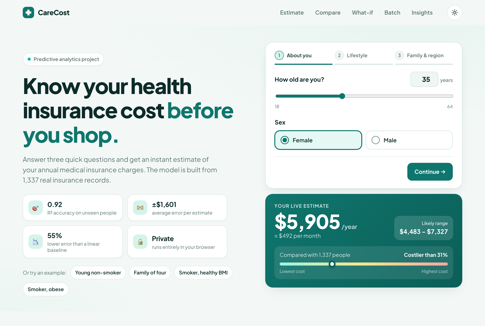
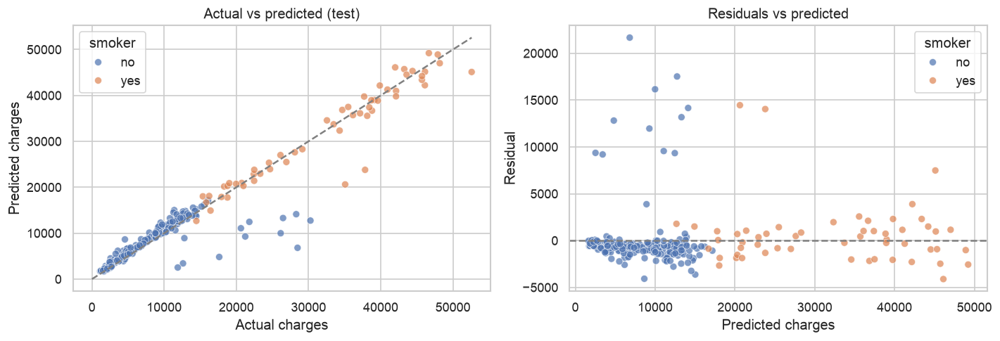
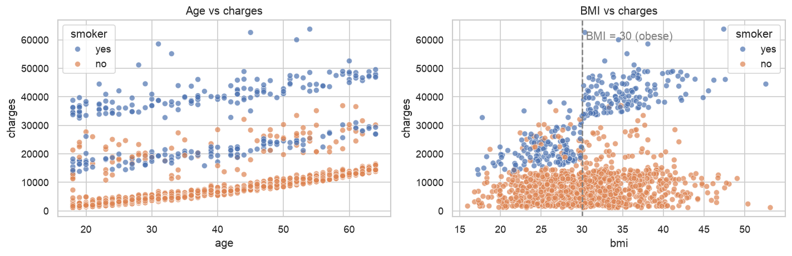
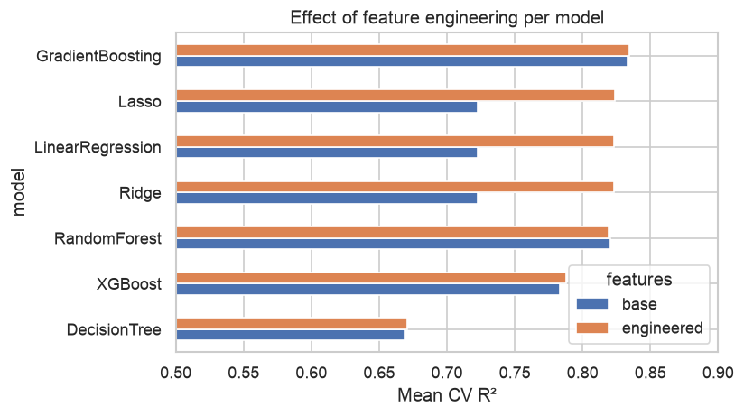
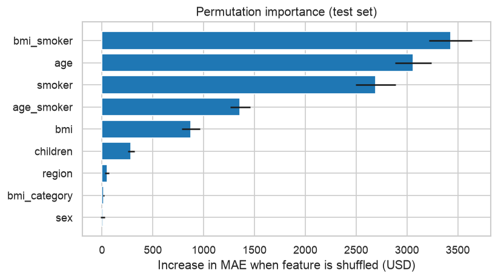

# Medical Insurance Cost Predictor

Predictive analytics project that estimates a person's **annual medical insurance charges** from their age, sex, BMI, number of children, smoking status and region. The final model is tuned Gradient Boosting with engineered interaction features and a log-transformed target. On a held-out test set it reaches **R² = 0.92** with a **mean absolute error of about $1,600**. That is about 55% lower than a linear-regression baseline.

It comes with an interactive website, **CareCost**, where you can price a profile, explore what-if scenarios and score a whole CSV. The trained model runs entirely in the browser.

**Live demo:** https://nsnehalshah2-web.github.io/Medical-insurance/



## Problem statement

Insurers price policies from expected cost. This project answers two questions:

1. **Prediction:** how accurately can we estimate an individual's yearly charges?
2. **Explanation:** which factors drive cost, and how do they interact?

## Dataset

[Medical Cost Personal Dataset](https://www.kaggle.com/datasets/mirichoi0218/insurance) (Kaggle): 1,338 records (1,337 after removing one duplicate), no missing values.

| Column | Description |
|---|---|
| `age` | Age of the primary beneficiary |
| `sex` | female / male |
| `bmi` | Body mass index (kg/m²) |
| `children` | Number of dependents covered |
| `smoker` | yes / no |
| `region` | northeast, northwest, southeast, southwest (US) |
| `charges` | **Target:** annual medical cost billed (USD) |

## Approach

1. **Data quality:** check types, missing values and duplicates.
2. **EDA:** examine the target distribution (strong right skew), cost by category, and relationships with age and BMI split by smoking status.
3. **Feature engineering** ([`src/features.py`](src/features.py)), driven by the EDA:
   - `bmi_smoker` = BMI × smoker, because BMI only raises cost for smokers
   - `age_smoker` = age × smoker
   - `bmi_category`: WHO bands, which capture the jump at BMI 30
4. **Leak-free pipeline:** scaling and one-hot encoding happen inside a scikit-learn `Pipeline`. The train/test split is stratified on smoker.
5. **Model comparison:** 7 algorithms × 2 feature sets, compared with 5-fold cross-validation.
6. **Hyperparameter tuning:** `GridSearchCV` over Gradient Boosting, with and without a log-transformed target.
7. **Evaluation:** test-set MAE, RMSE and R², residual analysis, and an error breakdown by group.
8. **Interpretation:** permutation feature importance.
9. **Deployment:** saved model, a prediction function and a command-line predictor.

## Results

**Cross-validation, mean of 5 folds (selected rows):**

| Model | Features | CV MAE | CV R² |
|---|---|---|---|
| Gradient Boosting | engineered | 2,775 | 0.834 |
| Random Forest | base | 2,846 | 0.820 |
| Linear Regression | engineered | 3,067 | 0.823 |
| Linear Regression | base | 4,393 | 0.722 |

**Final test set (268 people, never seen during training or tuning):**

| Model | MAE | RMSE | R² |
|---|---|---|---|
| Baseline: Linear Regression | $3,593 | $5,087 | 0.820 |
| **Tuned Gradient Boosting + log target** | **$1,601** | **$3,303** | **0.924** |



## Key insights

- **Smoking is the biggest cost driver.** Smokers average about $32,050 a year, against about $8,440 for non-smokers.
- **BMI matters only for smokers.** Obese smokers average about $41,560, compared with about $21,360 for non-obese smokers. For non-smokers the difference is under $900.

  

- **One interaction feature changes the picture.** `bmi_smoker` is the most important feature. It lifts plain linear regression from CV R² 0.72 to 0.82.

  
  

- **Log-transforming the skewed target** reduced the tuned model's CV MAE from about $2,700 to about $2,230.
- **Sex and region** add almost no predictive value.

## Website features (UI/UX)

The site is in [`docs/`](docs): plain HTML, CSS and JavaScript, with no build step and no backend.

- **Guided 3-step quote** (*About you → Lifestyle → Family & region*) in a clean health-and-finance style. It includes:
  - large tap-friendly choices, sliders and a children counter;
  - a built-in **BMI calculator** that works from height and weight;
  - four one-click example profiles.
- **Live estimate card:** shows, and updates as you type:
  - the annual and monthly cost;
  - a **likely range** (8 in 10 test predictions fell within it);
  - a percentile bar comparing the cost with all 1,337 people.
  - On phones, a **sticky estimate bar** keeps the price visible while you scroll.
- **"What would change your cost?" cards:** counterfactuals for the current profile, such as quitting smoking, reaching a healthy BMI, being 10 years older or having one more child. Each shows the exact dollar difference.
- **Interactive chart:** all 1,337 people by age or BMI, coloured by smoker status. Hovering shows actual and predicted charges, and clicking loads that person's profile.
- **What-if explorer:** vary one factor (age, BMI, smoking, children, region or sex) with everything else fixed. It draws the model's response curve or bars and writes a plain-English insight, for example that a smoker's cost jumps about $16,000 at BMI 30.
- **Batch predictions:** drag and drop a CSV of people.
  - Headers and values are matched flexibly: Gender/Sex, M/F, TRUE/1, "North East".
  - It shows totals and averages, and if the file has actual charges, the model's accuracy on it (MAE and R²).
  - Invalid rows get clear reasons, and values outside the training range are flagged.
  - The results CSV is downloadable, and nothing leaves the browser.
- **Inside the model:** the pipeline steps, a cross-validated comparison of the models, permutation importance and a test-set scorecard.
- **Light and dark themes**, a **responsive** layout for phone, tablet and desktop, and **accessibility** support: keyboard navigation, labelled controls, a skip link and reduced-motion support.
- **Exact:** the browser re-implements the full scikit-learn pipeline: feature engineering, scaling, one-hot encoding and all 100 boosted trees. It matches `model.predict` to within $0.000001 on 4,374 test profiles, including the BMI category boundaries.

## Project structure

```
Medical-insurance-cost-predictor/
├── data/
│   └── insurance.csv                  # raw dataset
├── notebooks/
│   └── insurance_cost_prediction.ipynb   # full analysis, with outputs
├── src/
│   ├── features.py                    # feature engineering (shared)
│   ├── train.py                       # retrain and save the final model
│   ├── predict.py                     # CLI prediction for one person
│   └── export_web.py                  # export model + data for the website
├── models/
│   └── insurance_model.joblib         # trained model
├── docs/                              # website (GitHub Pages)
│   ├── index.html, styles.css, app.js
│   ├── predictor.js                   # the model, re-implemented in JavaScript
│   └── data/model.json, model.js      # exported trees, scaler, encoder, data
├── images/                            # figures and screenshot used in this README
├── requirements.txt
└── README.md
```

## How to run

```bash
git clone https://github.com/nsnehalshah2-web/Medical-insurance.git
cd Medical-insurance-cost-predictor
python -m venv .venv && source .venv/bin/activate   # Windows: .venv\Scripts\activate
pip install -r requirements.txt
```

**Open the website:** double-click `docs/index.html`, or serve it locally:

```bash
python -m http.server 8000 --directory docs
```

Then visit http://localhost:8000.

**Explore the analysis:**

```bash
jupyter notebook notebooks/insurance_cost_prediction.ipynb
```

**Retrain the model** (writes `models/insurance_model.joblib` and `models/metrics.json`):

```bash
python -m src.train
```

**Predict for a new person:**

```bash
python -m src.predict --age 35 --sex male --bmi 33 --children 2 --smoker yes --region southeast
```

**Refresh the website's model** after retraining:

```bash
python -m src.export_web
```

## Deploy the website (GitHub Pages)

Push the repository, then go to **Settings → Pages → Build and deployment**. Choose **Deploy from a branch**, select branch `main` and folder **`/docs`**, and save. If Pages publishes `/ (root)` instead, the small `index.html` at the root redirects visitors to `docs/`, so the link works either way. The site goes live at https://nsnehalshah2-web.github.io/Medical-insurance/ within a minute or two.

## Limitations and future work

- The dataset is small and has no medical history, so a few very high-cost cases can't be explained.
- The test split scored higher than training (0.92 vs 0.87 R²), so the cross-validated R² of about 0.83 is the more conservative estimate.
- The model learns historical pricing. Any use in real pricing would need a fairness review.
- **Next steps:** prediction intervals with quantile regression, and SHAP explanations for each person.

## Tech stack

Python · pandas · NumPy · scikit-learn · XGBoost · Matplotlib · Seaborn · Jupyter · HTML · CSS · JavaScript (no frameworks) · GitHub Pages
